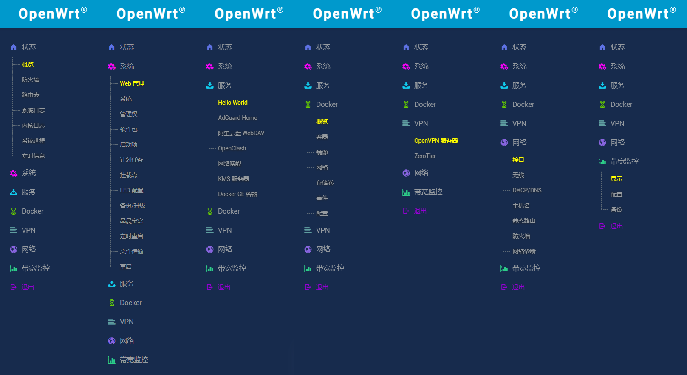

# 斐讯 N1 OpenWrt 固件

本项目使用 GitHub Actions 编译 Lean 的 OpenWrt 源码，并打包成适用于斐讯 N1（S905D）的刷机镜像。

**[下载最新固件](https://github.com/huangqian8/Cloud-N1-OpenWrt/releases/latest)** · [查看构建记录](https://github.com/huangqian8/Cloud-N1-OpenWrt/actions/workflows/cloud-n1-openwrt.yaml)

## 编译方式

- **定时编译**　每周日北京时间 16:00 触发。
- **推送编译**　向 `main` 推送对 `script.sh`、`config.sh`、`.github/workflows/cloud-n1-openwrt.yaml` 或 `files/` 下文件的修改时触发。
- **手动编译**　在 Actions 页面选择 **Cloud N1 OpenWrt**，点击 **Run workflow**。

## 构建记录保留规则

保留最近 5 个 Release 和最近 5 次成功构建记录。连续失败时，保留每次失败的日志供排查。下一次构建成功后，自动清理此前已结束的失败或取消记录。

## 固件配置

编译目标为 QEMU ARM Virtual Machine，子目标为 64-bit ARM machines。完整编译选项见 [config.sh](config.sh)。

额外启用的插件和主题

- `luci-app-docker`
- `luci-app-dockerman`
- `luci-theme-opentomcat`
- `luci-app-adguardhome`
- `luci-app-amlogic`

保留的默认组件

- `luci-app-autoreboot`
- `luci-app-filetransfer`
- `luci-app-nlbwmon`
- `luci-app-ssr-plus`
  - `Include ChinaDNS-NG`
  - `Include MosDNS`
  - `Include Shadowsocks Simple Obfs Plugin`
  - `Include ShadowsocksR Libev Client`
- `luci-app-vlmcsd`
- `luci-app-wol`

必选组件

- `luci-app-firewall`

已禁用的组件和选项

- `luci-app-accesscontrol`
- `luci-app-arpbind`
- `luci-app-ddns`
- `Include rclone-webui`
- `Include rclone-ng (another webui)`
- `luci-app-turboacc`
  - `Include Flow Offload`
  - `Include Shortcut-FE CM`
  - `Include BBR CCA`
  - `Include Pdnsd`
- `UnblockNeteaseMusic Golang Version`
- `luci-app-upnp`
- `luci-app-vsftpd`

## 界面预览

查看 OpenWrt 管理界面截图

## 更新日志

查看完整更新记录（2020–2026）

- 20260515 修改打包脚本，获取实际内核版本，输出到 release 说明
- 20250424 修正底层编译环境 `Ubuntu 20.04` 弃用造成的编译错误
- 20250303 修正 `actions/upload-artifact` 版本升级造成的编译错误
- 20240224 更新配置
- 20231129 更新内核版本 6.1.63，删除失效的插件
- 20231015 更新内核版本 6.1.57，集成 `PassWall`
- 20231013 更新截图
- 20231009 更新内核版本 6.1.56
- 20230915 修正 Github Action 空间不足导致的打包失败，更新内核版本 6.1.52
- 20230619 修正 Github Action 空间不足导致的打包失败，更新内核版本 6.1.34
- 20230525 更新配置
- 20230523 更新配置
- 20230211 修正 `set-output` 有效性造成的编译错误，更新内核版本 6.1.10
- 20230118 更新内核版本 6.1.6
- 20221031 更新内核版本 6.0.6
- 20220917 更新配置
- 20220814 更新内核版本 5.19.1
- 20220731 更新内核版本 5.18.15
- 20220620 更新内核版本 5.18.5
- 20220509 更新配置，更新内核版本 5.17.5
- 20220428 添加自动打包命令，生成刷机固件
- 20220427 更新配置，Release 默认保留3个
- 20220426 更新依赖安装命令，更新配置
- 20210827 更新配置，具体功能见截图
- 20210210 修正源码更新造成的编译错误，集成 `docker`。脚本文件调整
- 20201124 修正 `set-env` 有效性造成的编译错误
- 20200926 修正 `openclash` 编译错误
- 20200727 `docker` 兼容性造成编译错误，暂不集成

## 致谢

- OpenWrt 源码来自 [Lean 的 LEDE 项目](https://github.com/coolsnowwolf/lede)。
- 云编译脚本参考 [P3TERX 的 Actions-OpenWrt](https://github.com/P3TERX/Actions-OpenWrt)。
- 固件打包使用 [ophub/flippy-openwrt-actions](https://github.com/ophub/flippy-openwrt-actions)。
